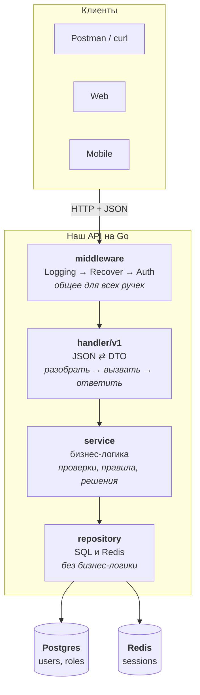
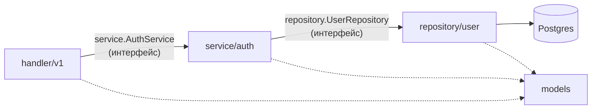
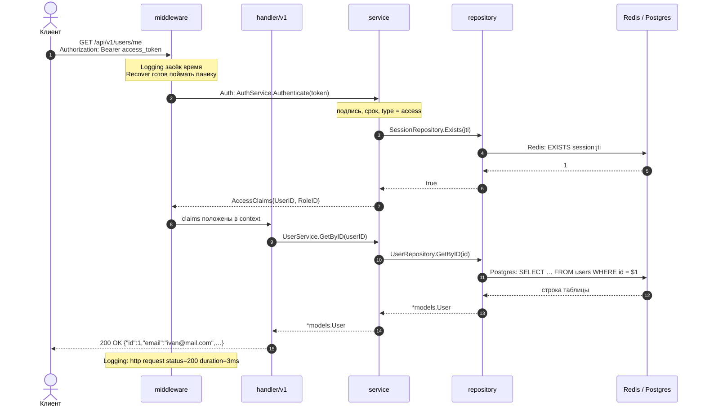
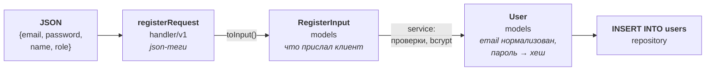
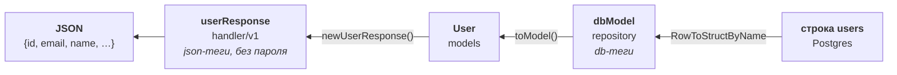
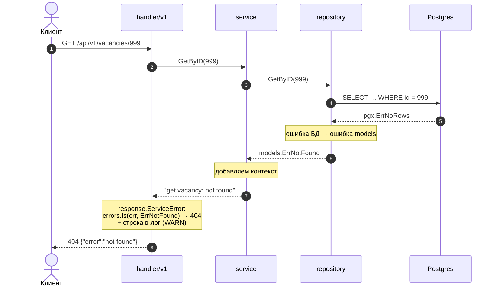

# Как добавить новую фичу

Гайд на сквозном примере: добавляем **вакансии** — создать вакансию и получить её по id.

```
POST /api/v1/vacancies       создать (нужен access-токен)
GET  /api/v1/vacancies/{id}  получить по id
```

> Диаграммы ниже — в формате Mermaid. GitHub, GitLab, GoLand и VS Code рисуют их прямо в предпросмотре markdown.

## Архитектура

Клиент — Postman, сайт в браузере или мобильное приложение — для нас одинаков: он шлёт HTTP-запрос с JSON и получает JSON в ответ. Внутри API запрос проходит слои сверху вниз, а ответ возвращается снизу вверх.



`models` на схеме нет: это общие структуры (`User`, `RegisterInput`) и ошибки (`ErrNotFound`), которыми пользуются все слои.

## Зоны ответственности

Аналогия — ресторан:

| Слой | В ресторане | Делает | НЕ делает |
|---|---|---|---|
| `middleware` | охранник на входе | пишет каждый запрос в лог, ловит паники, проверяет токен | бизнес-логику |
| `handler/v1` | официант | разбирает JSON, вызывает сервис, отвечает JSON, ошибки — через `response` | решает, можно ли; ходит в БД |
| `service` | повар | проверяет данные, применяет правила, вызывает репозитории, оборачивает ошибки | HTTP, JSON, SQL, логи |
| `repository` | кладовщик | один простой запрос в БД, перевод ошибок БД в ошибки `models` | бизнес-условия, логи |
| `models` | меню | структуры и общие ошибки | ввод-вывод, теги |

Официант не готовит и не ходит на склад, кладовщик не решает, что подать гостю. Каждый делает своё — поэтому любого можно заменить, не трогая остальных.

## Кто кого знает



- **Зависимости смотрят только вниз:** handler знает про service, service — про repository. Наоборот — никогда.
- **Слои связаны через интерфейсы** (`service.go`, `repository.go`). Сервису всё равно, Postgres внизу или фейк в тесте.
- **Собирает всё вместе `app.go`:** создаёт репозитории, передаёт их в сервисы, сервисы — в роутер.

## Жизненный цикл запроса

Пример — `GET /api/v1/users/me`: клиент с access-токеном спрашивает, кто он.



По шагам:

1. **Клиент** отправляет запрос. Для API неважно, Postman это или мобильное приложение.
2. **`Logging`** запоминает время старта, **`Recover`** готовится поймать панику, если она случится ниже.
3. **`Auth`** достаёт токен из заголовка и просит `AuthService` его проверить: подпись, срок, тип и что сессия есть в Redis. Не прошёл — сразу `401`, до ручки запрос не дойдёт.
4. **Ручка** берёт id пользователя из контекста и вызывает сервис.
5. **Сервис** просит репозиторий найти пользователя.
6. **Репозиторий** выполняет `SELECT` и превращает строку таблицы в `models.User`.
7. Ответ поднимается обратно: сервис → ручка. **Ручка** превращает `models.User` в JSON (без `password_hash`) и отвечает `200`.
8. **`Logging`** пишет в лог одну строку: метод, путь, статус, длительность.

## Как меняются данные по пути

У каждого слоя своя структура. На границах слоёв данные перекладываются из одной в другую — поэтому смена JSON не задевает БД, а смена таблицы не задевает API.

Пример — регистрация, `POST /api/v1/auth/register`:



Обратный путь — чтение пользователя:



| Структура | Слой | Теги | Зачем |
|---|---|---|---|
| `registerRequest`, `userResponse` | handler | `json` | формат API |
| `RegisterInput`, `User` | models | нет | с ними работает бизнес-логика |
| `dbModel` | repository | `db` | формат таблицы |

## Как путешествует ошибка

Ошибка создаётся внизу, по пути вверх обрастает контекстом, а наверху превращается в HTTP-статус. Пример — `GET /api/v1/vacancies/999`, такой вакансии нет:



| Где | Что делает с ошибкой |
|---|---|
| repository | ошибку драйвера → ошибка `models` (`ErrNoRows` → `ErrNotFound`, `23505` → `ErrEmailTaken`) |
| service | бизнес-отказ → ошибка `models`; ошибку снизу — обернуть: `fmt.Errorf("get vacancy: %w", err)` |
| handler | `response.ServiceError` выбирает статус и пишет лог: 4xx — WARN, 5xx — ERROR |

Неизвестная ошибка (упала БД, баг) → клиенту `500 internal server error` без подробностей, а в лог — вся цепочка: `get vacancy: select vacancy by id: connection refused`.

**Логи пишет только HTTP-слой** (middleware и `response.Error`). Сервис и репозиторий не логируют — иначе одна ошибка попала бы в лог трижды.

## Порядок работы

| Шаг | Файл |
|---|---|
| 1. Таблица | `migrations/002_vacancies.sql` |
| 2. Модели | `internal/models/vacancy.go` |
| 3. Интерфейс репозитория + поле в `Repositories` | `internal/repository/repository.go` |
| 4. Репозиторий | `internal/repository/vacancy/db_model.go`, `repository.go` |
| 5. Интерфейс сервиса + поле в `Services` | `internal/service/service.go` |
| 6. Сервис | `internal/service/vacancy/service.go`, по файлу на метод |
| 7. DTO и ручки | `internal/handler/v1/vacancy_dto.go`, `vacancy.go` |
| 8. Маршруты | `internal/handler/handler.go`, метод `InitRoutes` |
| 9. Сборка | `internal/app/app.go` |
| 10. Документация | `docs/openapi.yaml`, `README.md`, `docs/commands.txt` |

---

## 1. Миграция

`migrations/002_vacancies.sql`:

```sql
CREATE TABLE IF NOT EXISTS vacancies (
    id          BIGSERIAL   PRIMARY KEY,
    user_id     BIGINT      NOT NULL REFERENCES users(id),
    title       TEXT        NOT NULL,
    description TEXT        NOT NULL,
    created_at  TIMESTAMPTZ NOT NULL DEFAULT now()
);
```

- Файлы выполняются по алфавиту, поэтому номер в начале имени: `001`, `002`, ...
- Миграции применяются только при **первом** создании базы. Новый файл → `make infra-reset` (данные удалятся).

## 2. Модели

Файл = сущность: сама модель и входы её сценариев рядом. Без тегов.

`internal/models/vacancy.go`:

```go
package models

import "time"

type Vacancy struct {
	ID          int64
	UserID      int64
	Title       string
	Description string
	CreatedAt   time.Time
}

type CreateVacancyInput struct {
	Title       string
	Description string
}
```

`UserID` нет в `CreateVacancyInput`: автора берём из токена, а не из тела запроса — иначе можно создать вакансию от чужого имени.

Новая ошибка, которую нужно отличать от других, — в `internal/models/errors.go`. Для вакансий хватает существующих `ErrNotFound` и `ErrInvalidInput`.

## 3. Интерфейс репозитория

`internal/repository/repository.go` — интерфейс рядом с остальными и поле в `Repositories`:

```go
type Repositories struct {
	User    UserRepository
	Role    RoleRepository
	Session SessionRepository
	Vacancy VacancyRepository // ← новое поле
}

type VacancyRepository interface {
	Create(ctx context.Context, v *models.Vacancy) error
	GetByID(ctx context.Context, id int64) (*models.Vacancy, error)
}
```

`Repositories` — набор всех репозиториев: в `app.go` он собирается один раз, а сервисы берут из него то, что им нужно.

## 4. Репозиторий

Одна сущность — один пакет. Модель БД отдельно от `models`.

`internal/repository/vacancy/db_model.go`:

```go
package vacancy

import (
	"time"

	"demo-project/internal/models"
)

type dbModel struct {
	ID          int64     `db:"id"`
	UserID      int64     `db:"user_id"`
	Title       string    `db:"title"`
	Description string    `db:"description"`
	CreatedAt   time.Time `db:"created_at"`
}

func (m dbModel) toModel() *models.Vacancy {
	return &models.Vacancy{
		ID:          m.ID,
		UserID:      m.UserID,
		Title:       m.Title,
		Description: m.Description,
		CreatedAt:   m.CreatedAt,
	}
}
```

`internal/repository/vacancy/repository.go`:

```go
package vacancy

import (
	"context"
	"errors"
	"fmt"

	"github.com/jackc/pgx/v5"
	"github.com/jackc/pgx/v5/pgxpool"

	"demo-project/internal/models"
)

type Repository struct {
	db *pgxpool.Pool
}

func NewRepository(db *pgxpool.Pool) *Repository {
	return &Repository{db: db}
}

func (r *Repository) Create(ctx context.Context, v *models.Vacancy) error {
	err := r.db.QueryRow(ctx,
		`INSERT INTO vacancies (user_id, title, description)
		 VALUES ($1, $2, $3)
		 RETURNING id, created_at`,
		v.UserID, v.Title, v.Description,
	).Scan(&v.ID, &v.CreatedAt)
	if err != nil {
		return fmt.Errorf("insert vacancy: %w", err)
	}
	return nil
}

func (r *Repository) GetByID(ctx context.Context, id int64) (*models.Vacancy, error) {
	rows, err := r.db.Query(ctx,
		`SELECT id, user_id, title, description, created_at
		 FROM vacancies
		 WHERE id = $1`,
		id,
	)
	if err != nil {
		return nil, fmt.Errorf("select vacancy by id: %w", err)
	}
	m, err := pgx.CollectOneRow(rows, pgx.RowToStructByName[dbModel])
	if err != nil {
		if errors.Is(err, pgx.ErrNoRows) {
			return nil, models.ErrNotFound
		}
		return nil, fmt.Errorf("scan vacancy: %w", err)
	}
	return m.toModel(), nil
}
```

Правила:
- Только SQL. Никаких `WHERE status = 'open'` и «сначала SELECT, потом INSERT» — решения принимает сервис.
- `pgx.ErrNoRows` → `models.ErrNotFound`, нарушение `UNIQUE` (код `23505`) → своя ошибка из `models` (пример — `ErrEmailTaken` в `repository/user`).
- Имена колонок в `SELECT` совпадают с тегами `db`.

## 5. Интерфейс сервиса

`internal/service/service.go` — интерфейс и поле в `Services`:

```go
type Services struct {
	Auth    AuthService
	User    UserService
	Vacancy VacancyService // ← новое поле
}

type VacancyService interface {
	Create(ctx context.Context, userID int64, in models.CreateVacancyInput) (*models.Vacancy, error)
	GetByID(ctx context.Context, id int64) (*models.Vacancy, error)
}
```

## 6. Сервис

`internal/service/vacancy/service.go` — структура и конструктор:

```go
package vacancy

import (
	"demo-project/internal/repository"
	"demo-project/internal/service"
)

var _ service.VacancyService = (*Service)(nil)

type Service struct {
	vacancies repository.VacancyRepository
}

func NewService(vacancies repository.VacancyRepository) *Service {
	return &Service{vacancies: vacancies}
}
```

Сервис зависит от **интерфейса** репозитория, а не от Postgres: в тестах вместо БД подставляется фейк.

`internal/service/vacancy/create.go` — один публичный метод — один файл:

```go
package vacancy

import (
	"context"
	"fmt"
	"strings"

	"demo-project/internal/models"
)

func (s *Service) Create(ctx context.Context, userID int64, in models.CreateVacancyInput) (*models.Vacancy, error) {
	in.Title = strings.TrimSpace(in.Title)
	if in.Title == "" {
		return nil, fmt.Errorf("%w: title is required", models.ErrInvalidInput)
	}

	v := &models.Vacancy{
		UserID:      userID,
		Title:       in.Title,
		Description: in.Description,
	}
	if err := s.vacancies.Create(ctx, v); err != nil {
		return nil, fmt.Errorf("create vacancy: %w", err)
	}
	return v, nil
}
```

`internal/service/vacancy/get_by_id.go`:

```go
package vacancy

import (
	"context"
	"fmt"

	"demo-project/internal/models"
)

func (s *Service) GetByID(ctx context.Context, id int64) (*models.Vacancy, error) {
	v, err := s.vacancies.GetByID(ctx, id)
	if err != nil {
		return nil, fmt.Errorf("get vacancy: %w", err)
	}
	return v, nil
}
```

Правила:
- Ошибка для клиента — через ошибку из `models`: `fmt.Errorf("%w: title is required", models.ErrInvalidInput)`. По ней `response.ServiceError` выберет HTTP-статус.
- Ошибку снизу — всегда обернуть контекстом: `fmt.Errorf("create vacancy: %w", err)`.
- Никаких `http.*`, JSON и логов.

## 7. DTO и ручки

`internal/handler/v1/vacancy_dto.go`:

```go
package v1

import (
	"time"

	"demo-project/internal/models"
)

type createVacancyRequest struct {
	Title       string `json:"title"`
	Description string `json:"description"`
}

func (req createVacancyRequest) toInput() models.CreateVacancyInput {
	return models.CreateVacancyInput{
		Title:       req.Title,
		Description: req.Description,
	}
}

type vacancyResponse struct {
	ID          int64     `json:"id"`
	UserID      int64     `json:"user_id"`
	Title       string    `json:"title"`
	Description string    `json:"description"`
	CreatedAt   time.Time `json:"created_at"`
}

func newVacancyResponse(v *models.Vacancy) vacancyResponse {
	return vacancyResponse{
		ID:          v.ID,
		UserID:      v.UserID,
		Title:       v.Title,
		Description: v.Description,
		CreatedAt:   v.CreatedAt,
	}
}
```

`internal/handler/v1/vacancy.go` — новые методы общего `v1.Handler`. Сервис берётся из `h.services`, поэтому ни новых структур, ни конструкторов не нужно:

```go
package v1

import (
	"net/http"
	"strconv"

	"demo-project/internal/handler/middleware"
	"demo-project/internal/handler/response"
)

func (h *Handler) CreateVacancy(w http.ResponseWriter, r *http.Request) {
	var req createVacancyRequest
	if !decodeJSON(w, r, &req) {
		return
	}
	claims := middleware.ClaimsFromContext(r.Context())

	vacancy, err := h.services.Vacancy.Create(r.Context(), claims.UserID, req.toInput())
	if err != nil {
		response.ServiceError(w, r, err)
		return
	}

	response.JSON(w, http.StatusCreated, newVacancyResponse(vacancy))
}

func (h *Handler) GetVacancy(w http.ResponseWriter, r *http.Request) {
	id, err := strconv.ParseInt(r.PathValue("id"), 10, 64)
	if err != nil {
		response.Error(w, r, http.StatusBadRequest, "invalid id", err)
		return
	}

	vacancy, err := h.services.Vacancy.GetByID(r.Context(), id)
	if err != nil {
		response.ServiceError(w, r, err)
		return
	}

	response.JSON(w, http.StatusOK, newVacancyResponse(vacancy))
}
```

Ручка всегда делает три шага: **разобрать запрос → вызвать сервис → ответить**. Если в ручке появился `if` про бизнес-правило — его место в сервисе.

Все ручки — методы одного `v1.Handler`, поэтому имя включает сущность: `CreateVacancy`, `GetVacancy`, а не просто `Create`.

Статусы успеха: создание — `201`, чтение — `200`, изменение и удаление без тела — `204`.

## 8. Маршруты

`internal/handler/handler.go`, метод `InitRoutes` — добавить маршруты:

```go
func (h *Handler) InitRoutes() http.Handler {
	// ...

	mux.Handle("POST /api/v1/vacancies", requireAuth(http.HandlerFunc(apiV1.CreateVacancy)))
	mux.HandleFunc("GET /api/v1/vacancies/{id}", apiV1.GetVacancy)

	// ...
}
```

- Ручка только для залогиненных — обернуть в `requireAuth(...)`.
- Публичная — `mux.HandleFunc` без обёртки.
- `{id}` в пути читается в ручке через `r.PathValue("id")`.

## 9. Сборка в app

`internal/app/app.go` — по строке в `Repositories` и `Services`:

```go
import (
	// ...
	vacancyrepo "demo-project/internal/repository/vacancy"
	vacancyservice "demo-project/internal/service/vacancy"
)

	repos := &repository.Repositories{
		// ...
		Vacancy: vacancyrepo.NewRepository(postgresPool),
	}

	services := &service.Services{
		// ...
		Vacancy: vacancyservice.NewService(repos.Vacancy),
	}

	handlers := handler.NewHandler(services) // не меняется
```

Цепочка сборки всегда одна: `Repositories → Services → Handler → InitRoutes()`.

Алиасы (`vacancyrepo`, `vacancyservice`) нужны, потому что пакеты repository и service одной сущности называются одинаково.

## 10. Проверка и документация

```bash
go build ./... && go vet ./...
make infra-reset   # если добавили миграцию
make run
```

Обновить `docs/openapi.yaml` (новые пути, схемы запросов и ответов, коды ошибок), `README.md` (ручки) и `docs/commands.txt` (curl-примеры).

---

## Если нужна настройка из конфига

Например, лимит длины заголовка. Без хардкода:

1. `internal/config/config.go` — поле с тегом и значением по умолчанию:
   ```go
   type Vacancy struct {
   	MaxTitleLen int `envconfig:"VACANCY_MAX_TITLE_LEN" default:"100"`
   }
   ```
   и поле `Vacancy Vacancy` в `Config`.
2. `.env.example` и `.env` — `VACANCY_MAX_TITLE_LEN=100`.
3. Передать значение в конструктор сервиса в `app.go`: `vacancyservice.NewService(repos.Vacancy, cfg.Vacancy.MaxTitleLen)`.

## Если нужна новая ошибка

1. `internal/models/errors.go`: `ErrVacancyClosed = errors.New("vacancy is closed")`.
2. Сервис возвращает её: `return nil, models.ErrVacancyClosed`.
3. `internal/handler/response/response.go`, `ServiceError` — какой статус:
   ```go
   case errors.Is(err, models.ErrVacancyClosed):
   	Error(w, r, http.StatusConflict, models.ErrVacancyClosed.Error(), err)
   ```
   Без этого шага клиент получит `500`.

## Новая версия API (v2)

Когда формат запроса или ответа нужно изменить так, что старые клиенты сломаются:

1. Новый пакет `internal/handler/v2/` со своим `Handler`, DTO и ручками.
2. В `InitRoutes`: `apiV2 := v2.NewHandler(h.services)` и маршруты `/api/v2/...` рядом с v1.
3. v1 не трогаем: старые клиенты продолжают работать.

Сервисы, репозитории, `middleware` и `response` — общие для всех версий.

## Чек-лист

- [ ] Миграция с номером, `make infra-reset`.
- [ ] `models`: модель и `...Input` без тегов, новые ошибки — в `errors.go`.
- [ ] Repository: интерфейс и поле в `Repositories` (`repository.go`), пакет сущности с `dbModel`, только SQL.
- [ ] Service: интерфейс и поле в `Services` (`service.go`), `var _ service.XxxService = (*Service)(nil)`, ошибки обёрнуты, без логов и HTTP.
- [ ] Handler: DTO с json-тегами, методы `v1.Handler` в файле сущности, ручка — разобрать → сервис → ответить, ошибки через `response`.
- [ ] Новая ошибка → `case` в `response.ServiceError`.
- [ ] Маршруты в `InitRoutes`, `requireAuth` где нужно.
- [ ] Сборка в `app.go`: строка в `Repositories` и в `Services`.
- [ ] Настройки — через `config` и `.env.example`, без хардкода.
- [ ] `go build ./... && go vet ./...`, ручка проверена через curl.
- [ ] `docs/openapi.yaml`, `README.md` и `docs/commands.txt` обновлены.
